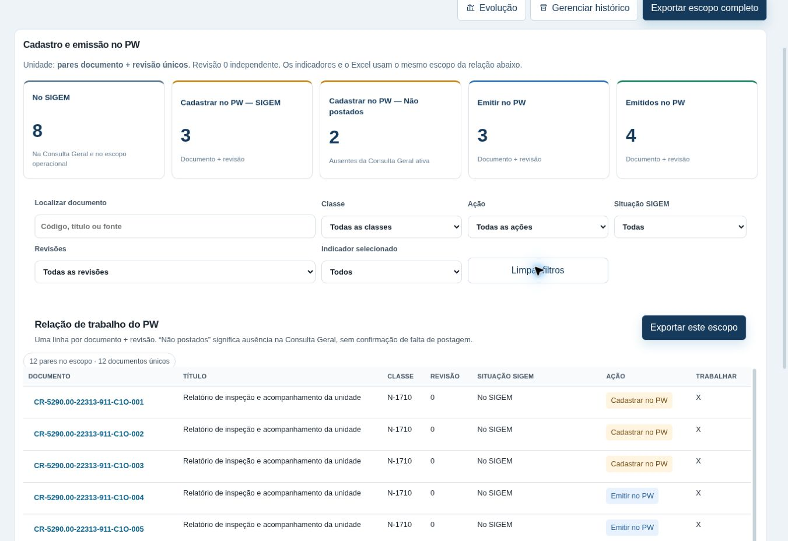

# SIGEM × PW: correção das contagens e da demanda PW

Implementação preparada em 04/11/2026 a partir de `0d00bcac6127632dff96e5b96f5350697a1856d2`. Não representa publicação em produção.

## Diagnóstico

| Causa encontrada | Efeito anterior | Correção |
|---|---|---|
| `reconcileManagerial` percorria toda a LD e agrupava cadastro pendente sem separar presença na Consulta Geral | O volume previsto parecia ser uma pendência originada no SIGEM | Dois grupos exclusivos, derivados da presença real de cada par na Consulta Geral |
| Cadastro e emissão eram agregados por código; qualquer revisão emitida podia contar como emissão do documento | Emissão de uma revisão mascarava outra revisão pendente | Chave documento + revisão; emissão exige evidência da própria revisão |
| Exportador marcava `pwRevisions`, isto é, revisões já encontradas no PW | X indicava disponibilidade, inclusive de revisões já emitidas | X somente na revisão pendente da linha; concluídas ficam sem X |
| Catálogo gerencial incluía ações de SIGEM, fiscalização e preparação | Coluna Ação exigia vários filtros e não expressava apenas trabalho PW | Três ações operacionais; conflitos e exceções ficam em diagnóstico |
| Cadastro gerencial acrescentava registros brutos de outras empresas | Empresas fora do filtro CSG/QTM interferiam no resultado oficial | Apenas CSG/QTM comprovam cadastro/emissão; a relação original permanece íntegra |
| Resumo e tela usavam escopos e unidades diferentes | Totais sem comparação verificável | Uma projeção compartilhada para filtros, cinco indicadores, classes e Excel |

## Contrato operacional

`sigemPwOperations.ts` centraliza a comparação e os filtros consumidos pela tela e pelo exportador. Usa a identidade documental e a normalização de revisão do core existente. Não altera importadores, persistência, regras fiscais ou outros módulos.

A unidade dos cinco indicadores é **par documento + revisão único**. O universo de revisões requeridas é a união das revisões explícitas nas referências e das revisões efetivamente encontradas na Consulta Geral para documentos das referências ativas. Não se escolhe automaticamente a maior revisão.

- `Cadastrar no PW — SIGEM`: par presente na Consulta Geral e sem cadastro PW aplicável.
- `Cadastrar no PW — Não postados`: revisão requerida da referência sem presença na Consulta Geral e sem cadastro PW aplicável.
- `Emitir no PW`: cadastro comprovado e emissão da revisão pendente.
- `Emitidos no PW`: emissão comprovada da revisão; ação `Concluído`.
- `No SIGEM`: pares da Consulta Geral que integram o escopo operacional.

Ausência na consulta não comprova ausência de postagem. Por isso a linha usa **Não consta na Consulta Geral**. Quando existe presença com revisão desconhecida, a ausência de outra revisão fica inconclusiva e não cria pendência presumida.

A coluna `Última emissão` usa as regras existentes do core: `Sim` comprova emissão atual, `Não` comprova emissão histórica e `Previsto` representa cadastro sem emissão. Emissões históricas da própria revisão também ficam como `Concluído`, sem X ou tarefa de emissão. Havendo duplicados, a evidência atual tem prioridade, seguida da histórica e do cadastro previsto.

`Previsto` é cadastro. Uma linha PW sem revisão comprova cadastro do código e permite a ação imediata de emissão da revisão requerida; ela não comprova emissão de uma revisão presumida. Cadastro de outra revisão explícita não resolve o cadastro da revisão requerida.

CV, cancelados e referências inconsistentes ficam separados das pendências. A conformidade fiscal continua sendo apurada pelo código existente; `Concluído` significa somente emissão no PW.

A conciliação mostra a Consulta Geral integral: registros disponíveis, documentos únicos, pares válidos nas/fora das referências, repetições e registros não interpretáveis. Linhas omitidas só são quantificadas quando a fonte informa `sourceRowCount`.

## Tela e Excel

A tela tem cinco indicadores, três ações, paginação de 25 linhas e detalhes de evidência por par. A abertura sem bases válidas mostra indicadores indisponíveis, sem apresentar zeros confirmados.

**Exportar este escopo** inclui os filtros da relação e apresenta exatamente os mesmos cinco totais. **Exportar escopo completo**, no cabeçalho, usa todas as classes e revisões das bases ativas. O Resumo informa o escopo exportado e a unidade.

O Excel contém Resumo com três blocos, relação consolidada, abas por classe real, relação PW original e conciliação. Registros fora das referências aparecem em aba separada quando existem. As abas por classe são visões da relação consolidada e não são somadas novamente. Os atributos originais PW, fórmulas F:H com linha exata de origem, códigos como texto, filtros e congelamento foram preservados. Revisões adicionais às colunas históricas são acrescentadas sem perder a indicação de X.

## Validação executada

- `npm test`: suíte geral aprovada, incluindo o novo teste operacional.
- `node tests/sigem_pw_operations.cjs`: 14 cenários solicitados e regressão da revisão PR #403 (revisões 0/A com Não/Sim concluídas, sem X), pares independentes 0/A/B, Previsto sem revisão, revisão desconhecida, empresas, duplicados, fontes múltiplas, reimportação, fontes ausentes e falha de análise.
- Arquivos XLSX gerados e reabertos com a biblioteca usada pelo GRCON: totais dos cinco indicadores, soma das classes, filtros, fórmulas, valores, texto literal e posição dos X verificados.
- Interação do componente React em jsdom: seleção de indicador, filtros enviados à exportação e valores indisponíveis durante conciliação incompleta.
- Homologação sintética: 6.041 documentos de referência e 29.421 linhas PW, com fórmulas ligadas à ocorrência correta de código, revisão e empresa; cancelados excluídos.
- Navegador: inspeção visual do componente real, filtro dos dois itens ausentes da Consulta Geral e escopo enviado ao exportador. O exportador real concluiu a geração na página de teste. A captura do evento de download pelo navegador remoto expirou; não há comprovação do arquivo baixado por essa via. A verificação binária do XLSX foi feita nos testes locais.
- `npm run build`, `typecheck`, `check:syntax`, `check:workers`, `check:references`, `check:versions`, `check:dependencies`, `check:supabase` e `git diff --check`: aprovados.
- `npm run build:cloudflare` e `npm run verify:cloudflare`: pacote com 341 arquivos validado. Nenhum workflow GitHub Actions foi acionado e nenhuma dependência ou serviço pago foi adicionado.

Não existe script `lint` no repositório. Foram usados os verificadores existentes de sintaxe e tipos.

## Publicação e limites

A alteração está preparada para revisão e integração em `main`. Depois da integração, usar o procedimento existente de Cloudflare Workers Builds, sem acionar os workflows manuais do GitHub. Confirmar o commit publicado antes de declarar produção atualizada.

Esta conversa trouxe o prompt, sem as planilhas corporativas atuais. Os testes são sintéticos e não estabelecem os números reais do contrato. A homologação com Consulta Geral, LDs e PW atuais e a confirmação do deploy continuam pendentes. Não foram alteradas bases corporativas nem publicado conteúdo em produção.

## Nomenclatura na tela e no Excel (atualização)

A unidade deixou de ser chamada de "par documento + revisão" e passou a ser **revisão de documento**: cada revisão de cada documento conta uma vez (o documento X nas revisões 0 e A são 2 revisões de documentos). A lógica de contagem não mudou; só os nomes.

| Antes | Agora |
|---|---|
| Pares (documento + revisão) | Revisões de documentos |
| No SIGEM | Constam no SIGEM |
| Cadastrar no PW — SIGEM | A cadastrar no PW — já constam no SIGEM |
| Cadastrar no PW — Não postados | A cadastrar no PW — não constam no SIGEM |
| Cadastrados no PW | Cadastradas no PW (a emitir + emitidas) |
| Emitir no PW | A emitir no PW |
| Emitidos no PW | Emitidas no PW |
| Constam nas referências | Constam nas LDs ativas |
| Trabalhar (coluna X) | Falta fazer (X) |

A tela tem a linha "Como ler os números" e o quadro "Entenda os números", e o Resumo do Excel traz a mesma explicação ("Como contar"). Os valores da coluna Ação (Cadastrar no PW, Emitir no PW, Concluído) continuam iguais.
